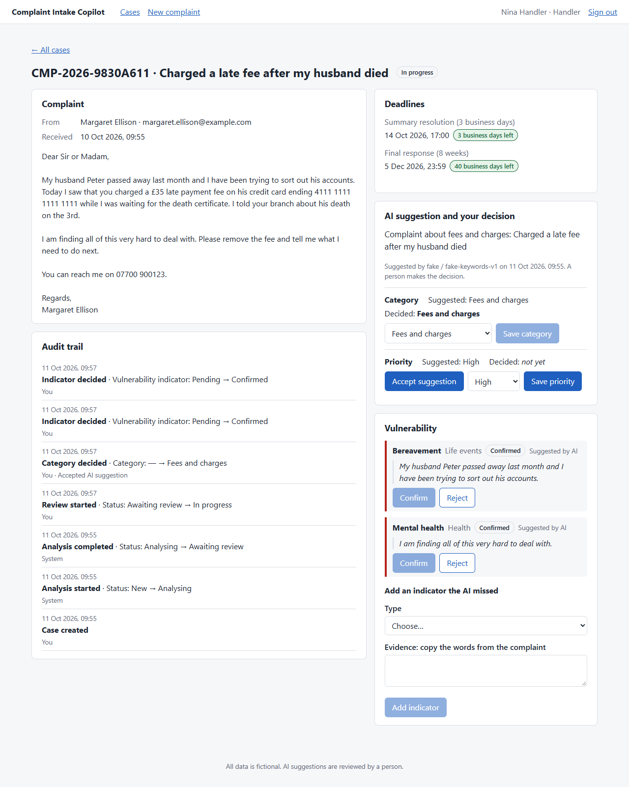
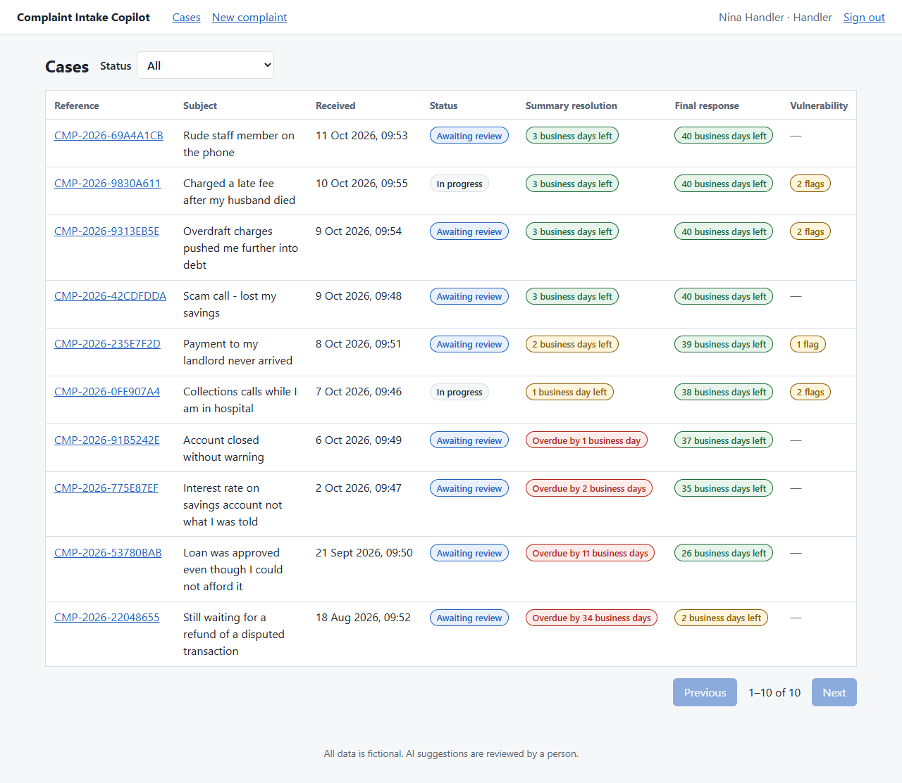
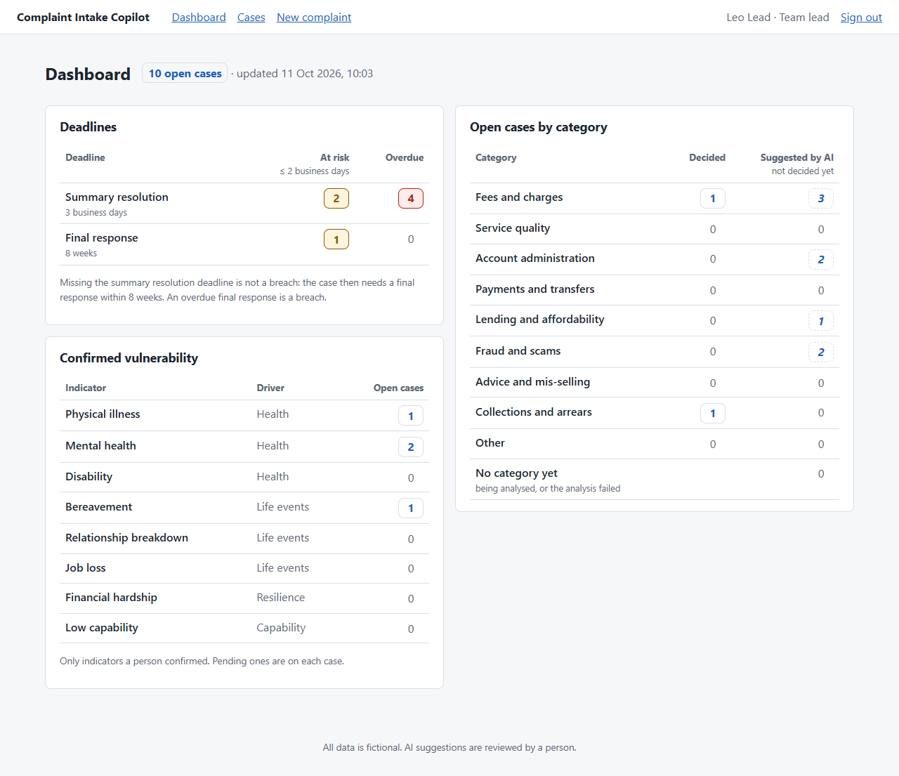

# Complaint Intake Copilot

AI-assisted intake for regulated complaints: each complaint email becomes a case with UK regulatory deadlines (FCA DISP 1.5 / 1.6), a suggested category, priority and vulnerability flags with evidence. Personal data is redacted before it reaches the model, and a person makes every final decision.



## In one minute

A complaint email arrives. It becomes a case at once, with its two FCA deadlines. In the background, the complaint is stripped of personal data and sent to a language model, whose answer is checked like any untrusted input. A complaint handler then accepts or overrides each suggestion, and every change is audited. A team lead sees what is close to breach.

What the project demonstrates:

- **Regulatory rules as tested code, not prompts.** DISP 1.5 / 1.6 deadlines with UK bank holidays per region, as pure functions; the model is never asked when a deadline is.
- **AI treated as untrusted input.** Personal data is redacted before every call (enforced by the type system), the answer must match a strict schema, evidence must be quoted word for word, and a person makes every decision.
- **Reliable background work.** A transactional outbox, an idempotent worker, retries with backoff and a dead-letter queue on RabbitMQ.
- **Multi-tenancy that is proven.** One test per endpoint, plus a test that no code outside the repositories filters by tenant.
- **Every acceptance criterion traced to a test** ([traceability](docs/traceability.md)). CI starts the whole Docker Compose stack and smoke-tests it through the web server on every push.

**Status:** complete. All eight milestones are done: backend foundation, tenant isolation, deadline engine, queue and worker, AI analysis with PII redaction, the handler's web app, the team lead dashboard, and the final hardening (traceability, end-to-end stack test).

**Stack:** Python 3.12 · FastAPI · Pydantic v2 · SQLAlchemy 2 · Alembic · PostgreSQL · Docker Compose · GitHub Actions (ruff, mypy, pytest)
**Messaging:** RabbitMQ · transactional outbox · idempotent worker with retries and a dead-letter queue
**AI:** OpenAI-compatible provider (OpenAI or Azure OpenAI) · offline fake provider · PII redaction before every call
**Front end:** React 19 · TypeScript (strict) · Vite · TanStack Query · API types generated from OpenAPI · Vitest · nginx with a strict CSP

## Run it

Requires Docker.

```bash
docker compose up --build
```

This starts PostgreSQL and RabbitMQ, applies the Alembic migrations, loads fictional demo data, serves the API and the web app, and runs the outbox relay and the analysis worker. The seeded complaints are analysed by the offline fake model within seconds, with no API key.

Create the first administrator after startup:

```bash
docker compose exec api python -m app.devtools.create_admin --email admin@example.com
```

The command prompts for a password (at least 8 characters). Use the email and password to sign in.
An actual mailbox is not required for local use; no email is sent. Administrators create other
accounts under **Accounts**, selecting handler/team lead and optional account-management permission.
Sessions expire after eight hours and are revoked on sign-out. Five failed password attempts lock
an account for fifteen minutes. Demo bearer tokens are disabled by default.

- **Web app:** http://localhost:8080
- **API docs (Swagger UI):** http://localhost:8000/docs
- **RabbitMQ management UI:** http://localhost:15672 (`cic` / `cic`, local only): queues `case.analysis`, `case.analysis.retry`, `case.analysis.dead`
- **Legacy test tokens:** API-only, available only when `ALLOW_DEMO_TOKENS=true`. The UI uses email and password.

| Tenant (fictional) | Role | Token |
|---|---|---|
| Northbridge Bank | handler | `demo-nb-handler` |
| Northbridge Bank | team lead | `demo-nb-lead` |
| Harbour Lane Building Society | handler | `demo-hl-handler` |
| Harbour Lane Building Society | team lead | `demo-hl-lead` |

Each tenant only ever sees its own cases. Try opening a Northbridge case id with a Harbour Lane token: you get a 404.

To check a running stack end to end (seeded cases analysed, tenant isolation, the dashboard, and a new complaint all the way to an audited decision):

```bash
python scripts/smoke_test.py
```

CI runs the same script against a fresh `docker compose up` on every push.

### Without Docker

For front-end work, or a machine where Docker cannot run (it needs CPU virtualisation, which some games' anti-cheat software does not allow):

```bash
cd backend && python -m app.devtools.local_stack      # API on http://127.0.0.1:8000
cd frontend && npm install && npm run dev             # web app on http://127.0.0.1:5173
```

The local stack runs the real code on SQLite, and hands analysis jobs straight from the outbox to the worker code instead of going through RabbitMQ. Docker Compose remains the real way to run the system.

## Develop and test

```bash
cd backend
python -m venv .venv
.venv/Scripts/activate        # Windows; on macOS/Linux: source .venv/bin/activate
pip install -e ".[dev]"
pytest                         # fast, uses in-memory SQLite
ruff check . && mypy app tests
```

The front end has its own checks (`npm run lint`, `npm run typecheck`, `npm test`, `npm run build`): see [frontend/README.md](frontend/README.md).

CI runs the same checks, audits every dependency for known vulnerabilities (`pip-audit`, `npm audit`), checks the front end's API types still match the backend, applies and verifies the migrations, runs the full test suite against **PostgreSQL** and **RabbitMQ**, builds and starts the web app's nginx image, and finally starts the whole Compose stack and runs the smoke test against it, on every push.

[docs/traceability.md](docs/traceability.md) lists, for every acceptance criterion, the tests that prove it.

## Background processing

A new case returns at once; its analysis runs in the background (US-1).

1. The case, its audit event and an **outbox** row commit in one transaction. The API never calls RabbitMQ, so a broker outage cannot lose a case or a job.
2. The **outbox relay** publishes pending rows to the `case.analysis` queue (publisher confirms, persistent messages).
3. The **worker** handles each job once: a `processed_messages` row makes redeliveries harmless. It loads the case by case id **and** tenant id. Transient failures retry with backoff (2 s, 4 s, 8 s, 16 s) through a retry queue; invalid messages and permanent failures go to the dead-letter queue.


## AI analysis

The worker turns each complaint into **suggestions** for a person to review (US-2):

```
complaint ──▶ redact personal data ──▶ LLM ──▶ validate ──▶ suggestions ──▶ handler decides
             [NAME_1] [CARD_1] ...              schema       category       accept / override
             (original stays in our DB)         real quotes  priority       confirm / reject
                                                             indicators     (all audited)
```

- **Redaction first, enforced by types.** The provider interface only accepts `RedactedText`, which only the redactor creates. Sending raw text to a model does not type-check. The exact text that was sent is stored on each analysis.
- **The model is untrusted input.** Its JSON must match a strict schema, and every vulnerability indicator must quote the complaint **word for word**, or it is dropped. An invalid answer is retried once; a second invalid answer sends the case to `needs_human_review` with the reason.
- **Rules live in code, not in the prompt.** Any vulnerability indicator lifts the suggested priority to at least `high`.
- **The AI never decides.** Suggestions and decisions are stored separately: overriding a suggestion never destroys it. Every decision is audited with who, when, and whether it accepted or overrode the AI.

### Use a real model

The default `fake` provider is a deterministic keyword model: the demo and the tests need no key and cost nothing. To use a real model, set:

```bash
LLM_PROVIDER=openai          # or azure_openai
LLM_API_KEY=...              # never committed; read from the environment
LLM_MODEL=gpt-4o-mini        # any chat model with JSON output
LLM_BASE_URL=                # Azure: https://<resource>.openai.azure.com/openai/v1/
```

### Known limitations (honest)

- **Names in free text are not always caught.** Regex redaction catches the sender's name and names after greetings and sign-offs, but not a relative mentioned in passing ("my husband Peter"). A production system would add an NER model (e.g. Microsoft Presidio) and Azure OpenAI with UK data residency.
- **Not every kind of personal data has a rule.** Emails, phones, cards, accounts, sort codes, postcodes, names, National Insurance numbers and dates of birth do. Street addresses (beyond the postcode) and IBANs do not yet.
- **Authentication:** administrator-created password accounts, scrypt hashes and hashed, expiring session tokens. Public deployment still needs HTTPS, edge rate limiting and an operational account recovery process.
- **Prompt injection is contained, not prevented.** The complaint is fenced as data and the model is told to ignore instructions in it. What protects the firm is the rest: strict output validation, evidence checks, and a person making every decision.

## Regulatory deadlines

Every case gets two deadlines at intake, calculated in UK time by pure functions in [`app/domain/deadlines.py`](backend/app/domain/deadlines.py):

- **Summary resolution (SRC):** 17:00 on the third business day after the day of receipt (DISP 1.5.1R)
- **Final response:** end of the day, 8 weeks after receipt (DISP 1.6.2R)

Business days skip weekends and the tenant's regional UK bank holidays. Each read of a case adds a `deadline_tracking` block: business days remaining, overdue, or resolved in time.



Bank holidays come from a local copy of the gov.uk feed. The app never calls gov.uk at runtime. To refresh the file (validated before it is written):

```bash
cd backend
python -m app.reference_data.refresh_bank_holidays
```

## Team lead dashboard

Sign in with a team lead account and open **Dashboard**. For the open cases of your own tenant it shows:

- **Deadlines:** cases **at risk** (2 business days or fewer left) and **overdue**, for each deadline separately. Missing the SRC deadline is not a breach (the case then needs a final response within 8 weeks), so it is not mixed up with an overdue final response, which is.
- **Categories:** decided by a person, and suggested by the AI but not decided yet, in separate columns, so a suggestion is never read as a decision.
- **Vulnerability:** cases with a confirmed indicator, per type and FCA driver.



Every number is a link to the case list with the matching filters (`GET /cases?open=true&deadline=src&deadline_risk=overdue`, and so on). The dashboard and the list are built from the same query conditions, and a test checks every number against the list it opens. A handler calling `GET /dashboard` gets `403`.

## Documentation

- [Company notes](docs/company-notes.md): context and the regulatory rules used
- [Brief](docs/brief.md): the problem, users, scope
- [User stories](docs/user-stories.md): acceptance criteria
- [Traceability](docs/traceability.md): each acceptance criterion and the tests that prove it
- [Data model](docs/data-model.md)
- [Architecture](docs/architecture.md)

All complaint data in this repository is synthetic and fictional.


## Workspace tools

- Search references, subjects and complaint text; combine with inclusive received dates (UTC),
  ownership, status and deadline filters. Save a named view privately to your account, or use
  **My overdue cases** for your open cases with overdue final responses.
- Add internal comments or hand over a case with a required reason. Both appear in the same audit
  history as decisions and closure; comments are append-only.
- **Deadline alerts** refresh every thirty seconds. Handlers see their assigned cases; team leads
  see their tenant's cases. Summary-resolution and final-response dates are labelled separately.
- Generate response drafts, edit them and explicitly approve after review. Approved drafts are
  immutable; concurrent edits return a conflict. Approval never sends mail. With the default
  fake provider this is an explicitly labelled offline template. Configure `LLM_PROVIDER`,
  `LLM_API_KEY`, `LLM_MODEL` and optional `LLM_BASE_URL` for real generation. The existing redactor
  runs before generation; its documented limitations still apply.

The legacy smoke script uses API tokens. Run it only against an isolated stack started with
`ALLOW_DEMO_TOKENS=true`; normal password-only operation does not enable those tokens.
